# AWS Cloud Cost Optimization - Identifying Stale Resources

## Identifying Stale EBS Snapshots

In this example, we'll create a Lambda function that identifies EBS snapshots that are no longer associated with any active EC2 instance and deletes them to save on storage costs.

### Description:

The Lambda function fetches all EBS snapshots owned by the same account ('self') and also retrieves a list of active EC2 instances (running and stopped). For each snapshot, it checks if the associated volume (if exists) is not associated with any active instance. If it finds a stale snapshot, it deletes it, effectively optimizing storage costs.

## Cloud Cost Optimization: Auto-Delete Unused EBS Snapshots with AWS Lambda

### Step 1: Launch an EC2 instance
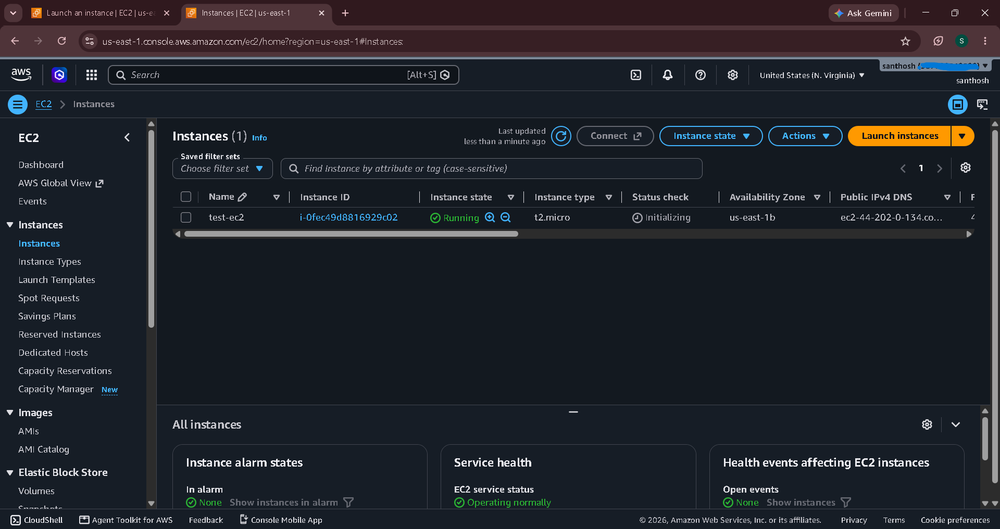

### EBS volume created and attached with the instance
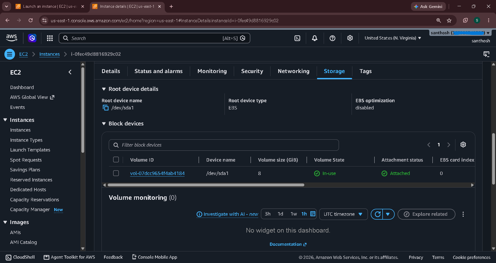

### Step 2: Create and deploy the Lambda function (Python)
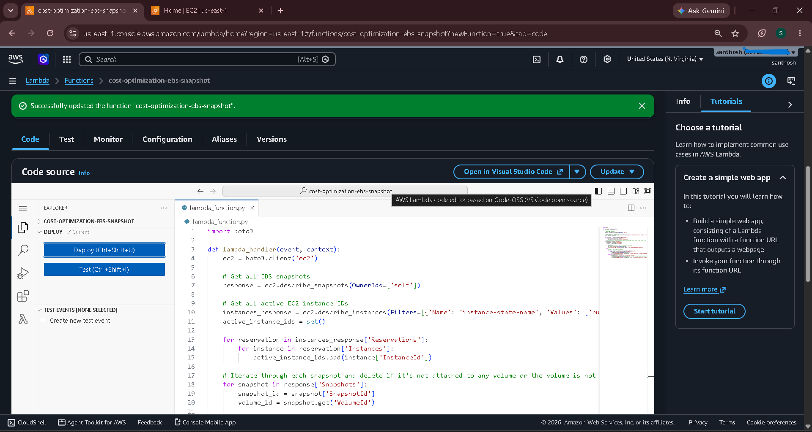

### Step 3: Create a test event
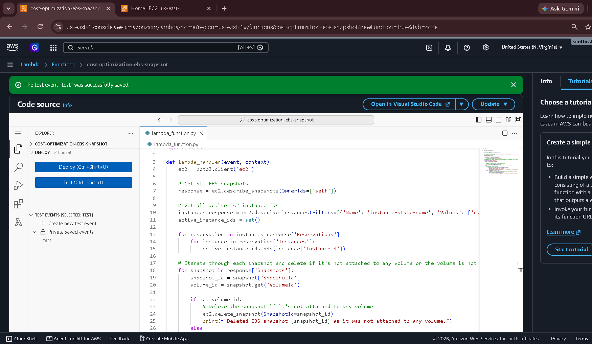

### Step 4: Create an IAM policy and attach it to the Lambda role
Permissions: `ec2:DescribeSnapshots`, `ec2:DeleteSnapshot`, `ec2:DescribeInstances`, `ec2:DescribeVolumes`

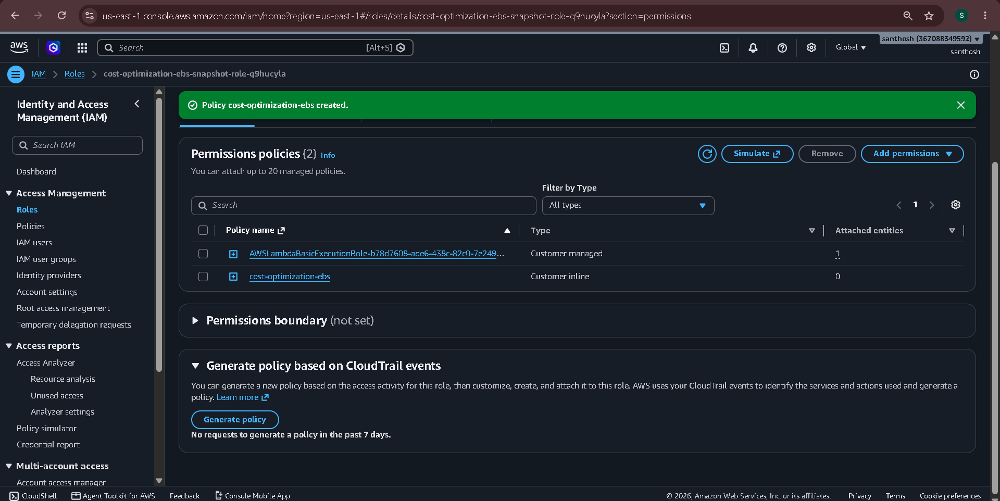

### Test 1: Instance running, so the snapshot is retained
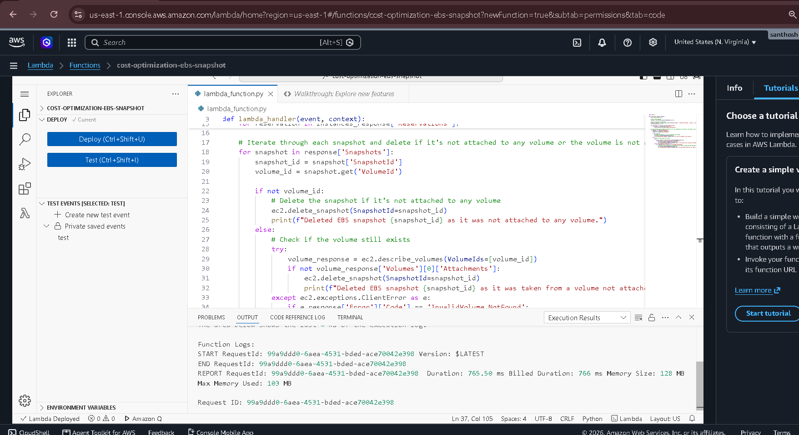

### Test 2: Terminate the EC2 instance (its volume is deleted)
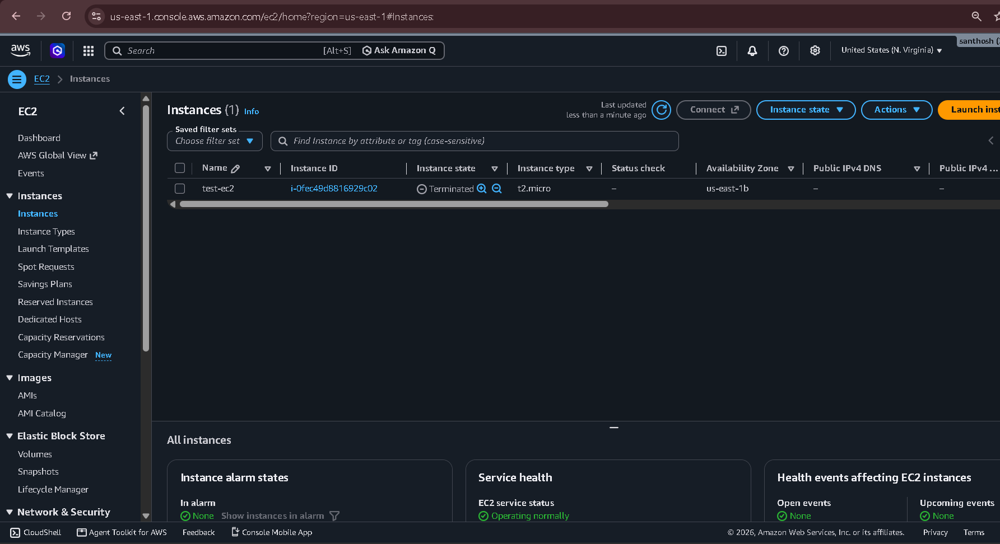

### Orphaned snapshot still exists after the volume is gone
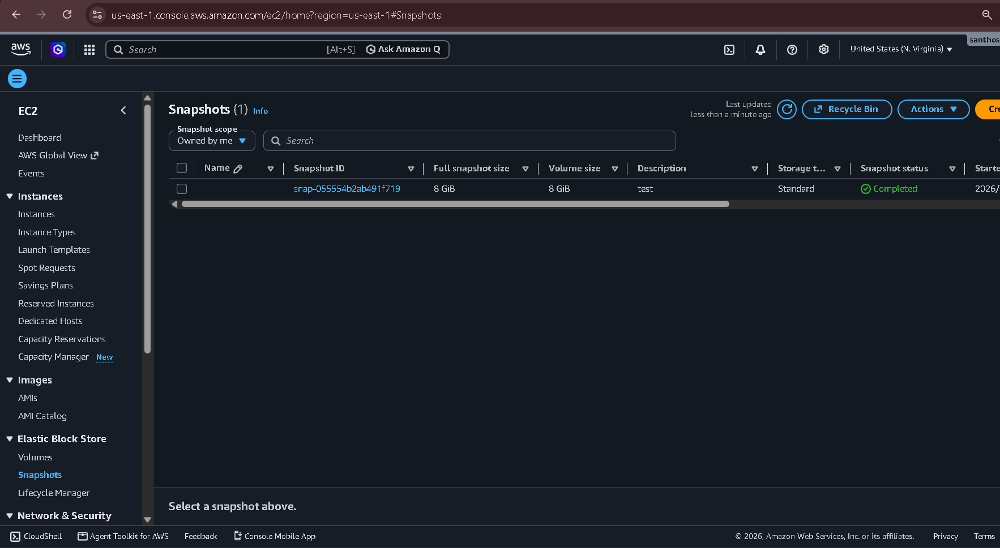

### Lambda run: orphaned snapshot deleted
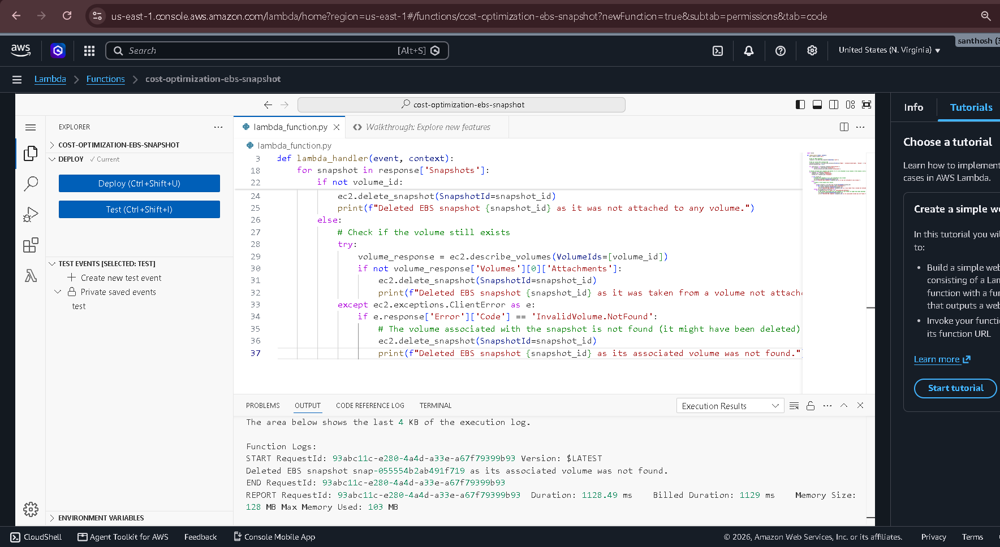

### Snapshots page after the run: no snapshots left
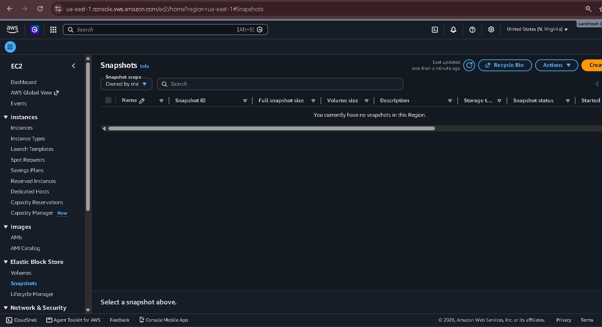

### Test 3: Snapshot created from a standalone volume (no instance attached)
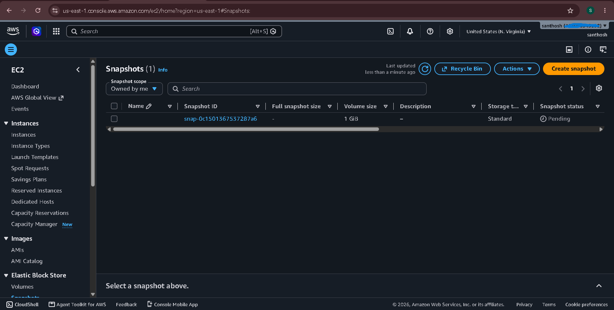

